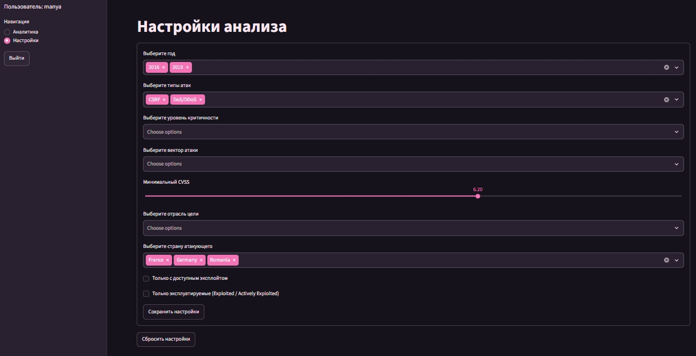
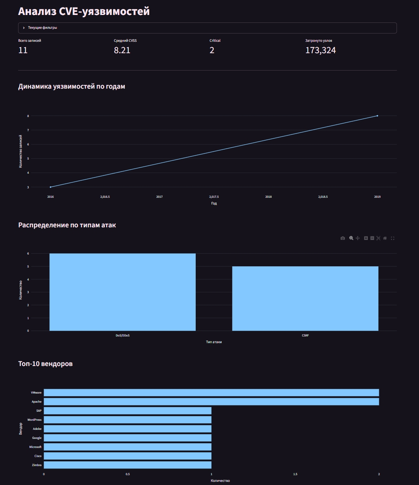
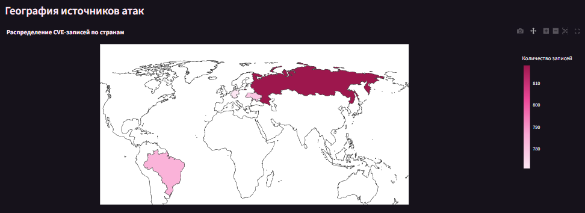
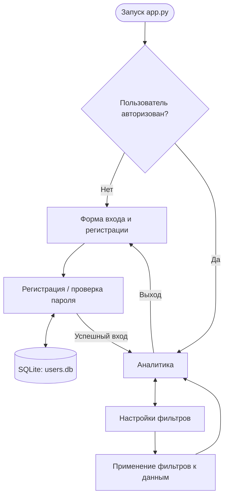
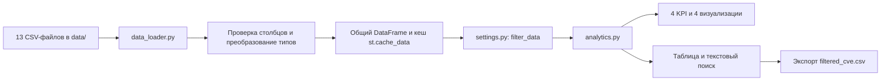

# РК-2 · Аналитика CVE

Многопользовательское веб-приложение для анализа учебного набора записей об уязвимостях CVE за 2014–2026 годы. Реализованы регистрация и вход, индивидуальные настройки фильтрации, таблица, KPI, интерактивные графики и экспорт результатов.

## Запуск

Проект запускается на из папки `CVE_Analytics_ready` в терминале:

python -m pip install -r requirements.txt
python -m streamlit run app.py

CSV-файлы `cyberattacks_cve_2014.csv` … `cyberattacks_cve_2026.csv` должны находиться в папке **`data/`**, рядом с модулями приложения. После запуска Streamlit откройте адрес, показанный в терминале (обычно `http://localhost:8501`). Остановка: `Ctrl+C`.

## Работа с приложением

| Шаг                  | Что сделать                                                                                | Что произойдёт                                                      |
| -------------------- | ------------------------------------------------------------------------------------------ | ------------------------------------------------------------------- |
| 1. Создать аккаунт   | Во вкладке «Регистрация» ввести логин, e-mail, пароль не короче 8 символов и подтверждение | Создаётся пользователь в SQLite; пароль хранится в виде bcrypt-хеша |
| 2. Войти             | На вкладке «Вход» ввести логин и пароль                                                    | Откроется раздел «Аналитика»                                        |
| 3. Выбрать параметры | Перейти в «Настройки», выбрать фильтры, нажать «Сохранить настройки»                       | Выбранные параметры используются при построении аналитики           |
| 4. Изучить данные    | Вернуться в «Аналитику»                                                                    | Обновятся KPI, диаграммы, карта и таблица                           |
| 5. Найти запись      | Ввести CVE ID, производителя или продукт в поле поиска                                     | Таблица покажет совпадения; поиск не изменяет графики               |
| 6. Скачать результат | Нажать «Скачать CSV»                                                                       | Скачается `filtered_cve.csv` с текущими строками таблицы            |
| 7. Выйти             | Нажать «Выйти» в боковом меню                                                              | Сессия завершается, отображается форма авторизации                  |

## Фильтры

| Параметр              | Как работает                                               |
| --------------------- | ---------------------------------------------------------- |
| Годы                  | Можно выбрать один или несколько годов от 2014 до 2026     |
| Типы атак             | Отбор по `attack_type`                                     |
| Критичность           | Отбор по `severity`                                        |
| Вектор атаки          | Отбор по `attack_vector`                                   |
| Страна атакующего     | Отбор по `attacker_country`                                |
| Отрасль цели          | Отбор по `target_sector`                                   |
| Минимальный CVSS      | Записи с `cvss_score` не ниже выбранного порога от 0 до 10 |
| Доступность эксплойта | Только записи с `exploit_available = Yes`                  |
| Статус эксплуатации   | Только записи с `status = Exploited`                       |

Пустой список в большинстве фильтров означает отсутствие ограничения по соответствующему признаку. **Пустой список годов** приводит к пустой выборке. Кнопка «Сбросить настройки» возвращает параметры по умолчанию.

### Пример интерфейса настроек




_Рисунок 1 — экран настроек пользователя manya._

## Что показывает аналитика

Вверху страницы располагаются четыре KPI, рассчитанные **по текущей отфильтрованной выборке**:

| KPI             | Значение                                   |
| --------------- | ------------------------------------------ |
| Всего записей   | Количество строк                           |
| Средний CVSS    | Среднее значение `cvss_score`              |
| Critical        | Количество записей с `severity = Critical` |
| Затронуто узлов | Сумма `affected_hosts`                     |

Ниже показаны четыре визуализации **Plotly**:

| Визуализация                  | Что показывает                                                      |
| ----------------------------- | ------------------------------------------------------------------- |
| Динамика уязвимостей по годам | Линейный график количества записей по годам                         |
| Распределение по типам атак   | Столбчатая диаграмма `attack_type`                                  |
| Топ-10 вендоров               | Горизонтальная диаграмма производителей с наибольшим числом записей |
| География источников атак     | Интерактивная карта мира по `attacker_country`                      |

### Пример карты мира



_Рисунок 2 — географическое распределение записей по странам, указанным в учебном наборе._

В нижней части страницы размещена таблица CVE. Поиск выполняется по `cve_id`, `vendor` и `product`, без учёта регистра. Таблицу можно сортировать средствами Streamlit. Кнопка скачивания экспортирует именно **найденные в таблице строки** в CSV с кодировкой UTF-8 BOM.

Если фильтры не дали совпадений, выводится сообщение «По выбранным фильтрам записей не найдено» вместо пустых графиков.

## Как работает приложение

### Доступ к страницам



В `app.py` проверяется `st.session_state.user`: пока пользователь не вошёл, вызывается `show_auth()` и разделы аналитики и настроек не отображаются. `auth.py` выполняет регистрацию, вход и работу с таблицами SQLite. Пароли проверяются с помощью `bcrypt.checkpw()`.



Загрузчик последовательно читает файлы за 2014–2026 годы, проверяет наличие обязательных столбцов, преобразует даты и числовые поля. Если отдельный файл отсутствует или не подходит по структуре, приложение выводит предупреждение. Визуализации и экспорт работают с результатом фильтрации.

## Структура

| Файл или каталог    | Назначение                                                                                 |
| ------------------- | ------------------------------------------------------------------------------------------ |
| `app.py`            | Точка входа Streamlit, навигация, проверка авторизации                                     |
| `auth.py`           | Регистрация, вход, bcrypt, SQLite, функции сохранения и загрузки пользовательских настроек |
| `settings.py`       | Форма фильтров, применение условий, сброс настроек                                         |
| `data_loader.py`    | Чтение годовых CSV, проверка структуры, преобразование полей и кеширование                 |
| `analytics.py`      | KPI, графики Plotly, карта мира, таблица, поиск и экспорт                                  |
| `data/`             | Годовые CSV `cyberattacks_cve_YYYY.csv`                                                    |
| `tests/`            | Автоматические проверки pytest                                                             |
| `docs/screenshots/` | Скриншоты для документации                                                                 |
| `requirements.txt`  | Зависимости Python                                                                         |

## Тестирование

Запуск из корня проекта:

```powershell
python -m pytest tests/ -v
```

### Проверяемые компоненты приложения

| Файл                            | Что проверяется                                                                                                                                                         |
| ------------------------------- | ----------------------------------------------------------------------------------------------------------------------------------------------------------------------- |
| `tests/test_auth.py`            | Регистрация и авторизация пользователей, проверка корректности учётных данных, обработка неверного логина и пароля, работа с пользовательскими настройками.             |
| `tests/test_data.py`            | Загрузка CSV-файлов, корректность обработки данных, применение фильтров и вычисление аналитических показателей.                                                         |
| `tests/test_data_validation.py` | Проверка структуры CSV, наличия обязательных столбцов, допустимых значений CVSS (0–10), корректности дат и количества затронутых узлов, обработка некорректных записей. |

Автоматизированное тестирование выполняется с использованием `pytest`. По результатам запуска успешно пройдены **18 тестов**. Проверки направлены на подтверждение корректности основных функций приложения и устойчивости к ошибочным входным данным.

На предоставленном скриншоте **18 тестов завершились успешно**. Проверяются сценарии регистрации и входа, bcrypt-хеширование, некорректные данные, SQL-инъекция через логин, загрузка CSV и изоляция настроек.


_Рисунок 3 — результат запуска pytest: 18 passed._
