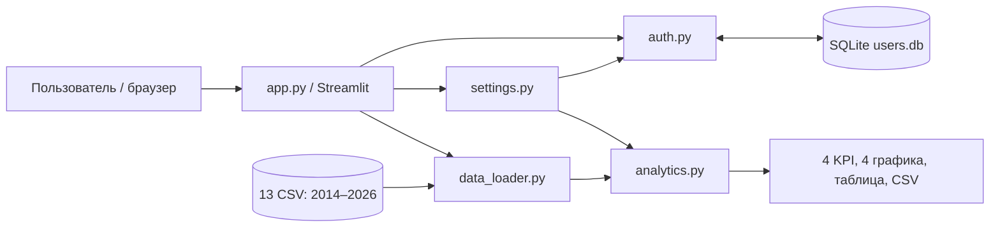
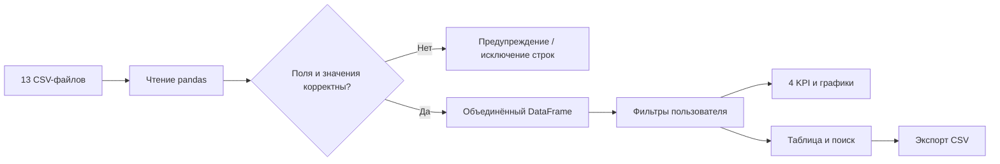
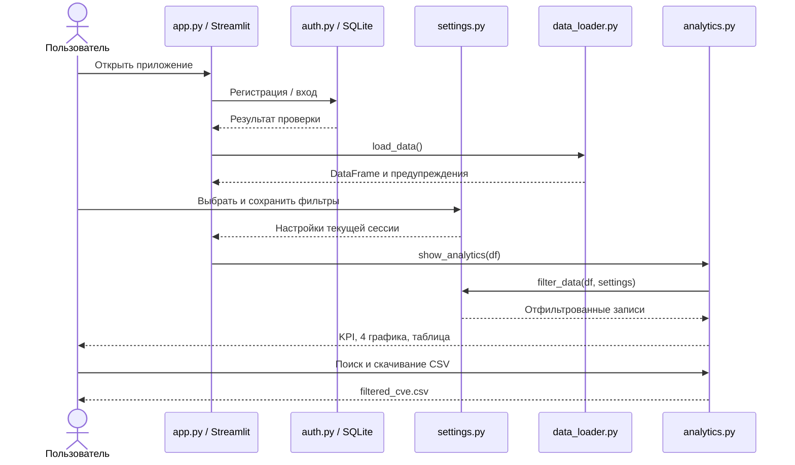

# РК-2. CVE Analytics — отчёт о запуске и проверке веб-приложения Streamlit

> **Предмет работы:** многопользовательское веб-приложение для анализа CSV-записей о CVE за 2014–2026 годы.

## 1. Постановка задачи

Разработать на Python и Streamlit приложение для регистрации и авторизации пользователей, чтения 13 годовых CSV-файлов, проверки входных данных, фильтрации, вычисления аналитических показателей, построения четырёх интерактивных визуализаций, поиска и выгрузки CSV. Предусмотреть обработку отсутствующих файлов, некорректных строк и пустой выборки.

## 2. Структура проекта

```text
CVE_Analytics_ready/
├── .streamlit/
├── data/
│   ├── cyberattacks_cve_2014.csv
│   ├── ...
│   └── cyberattacks_cve_2026.csv
├── tests/
│   ├── test_auth.py
│   ├── test_data.py
│   └── test_data_validation.py
├── .gitignore
├── analytics.py
├── app.py
├── auth.py
├── data_loader.py
├── README.md
├── requirements.txt
├── settings.py
```


_Рисунок 1 — структура реального проекта в IDE._

| Модуль           | Назначение                                                                |
| ---------------- | ------------------------------------------------------------------------- |
| `app.py`         | Точка входа, маршрутизация между аналитикой и настройками, контроль входа |
| `auth.py`        | Регистрация, проверка пароля bcrypt, взаимодействие с SQLite              |
| `data_loader.py` | Загрузка CSV, проверка полей, дат и числовых значений, кэширование        |
| `settings.py`    | Форма настройки, сохранение и применение фильтров                         |
| `analytics.py`   | Четыре KPI, четыре графика Plotly, таблица, поиск и экспорт               |
| `tests/`         | Автоматические проверки регистрации, данных и валидации                   |



В `auth.py` пароль проверяется с помощью `bcrypt.checkpw`; при регистрации хранится bcrypt-хеш. Для текущего входа применяется `st.session_state`. Настройки применяются в текущей сессии и сохраняются в SQLite для последующих входов

## 3. Подготовка и запуск


## 3. Подготовка и запуск

py -m venv .venv
.\.venv\Scripts\Activate.ps1
python -m pip install -r requirements.txt
python -m streamlit run app.py

После запуска приложение доступно по адресу
http://localhost:8501.

Для выполнения тестов:

python -m pytest -v

Исходные CSV-файлы должны находиться в папке `data/`.
Остановить приложение можно сочетанием `Ctrl+C`.

## 4. Загрузка и проверка исходных данных

`data_loader.py` обходит годы от 2014 до 2026, проверяет существование каждого файла и наличие 13 обязательных столбцов. Даты приводятся к формату `YYYY-MM-DD`, `cvss_score` и `affected_hosts` — к числам. Исключаются строки с отсутствующими обязательными значениями, CVSS вне диапазона 0–10, отрицательным числом затронутых узлов и датой не из года соответствующего файла. Предупреждения выводятся пользователю, корректные строки продолжают участвовать в анализе.


_Рисунок 2 — обнаружение и исключение некорректных строк CSV._


_Рисунок 3 — предупреждение об отсутствующем годовом CSV при продолжении работы с доступными файлами._

При проверке файла cyberattacks_cve_2026.csv обнаружено 13 некорректных строк. После их исключения общее количество записей уменьшилось с 15 847 до 15 834. Приложение вывело предупреждение и продолжило анализ остальных данных. При удалении годового CSV-файла приложение также продолжило работу с доступными файлами.



## 5. Автоматические тесты

Запуск из корня проекта:

```powershell
python -m pytest -v
```

В предоставленном выводе **18 тестов завершились успешно (`18 passed in 3.22s`)**. Тесты находятся в `tests/test_auth.py`, `tests/test_data.py` и `tests/test_data_validation.py`. Проверяются сценарии регистрации, входа, bcrypt, повторной регистрации, некорректных учётных данных, SQL-инъекции, изоляции настроек, годового диапазона, качества данных, поиска/экспорта и ошибок CSV.


| Файл | Что проверяется |
|---|---|
| `test_auth.py` | Регистрация пользователя, хеширование пароля, проверка логина и пароля, повторная регистрация, SQL-инъекции и независимость настроек пользователей |
| `test_data.py` | Корректность фильтрации, поиск и экспорт записей, работа с годовым диапазоном |
| `test_data_validation.py` | Загрузка корректного CSV, обработка неверных значений CVSS, некорректных дат, отсутствующего файла и несоответствия года |
  


_Рисунок 4 — успешное выполнение 18 автоматических тестов._

## 6. Регистрация и авторизация

При запуске неавторизованному пользователю доступны вкладки «Вход» и «Регистрация». Регистрация проверяет логин (не менее 3 символов), формат e-mail, пароль (не менее 8 символов) и совпадение подтверждения. В SQLite сохраняется bcrypt-хеш пароля, а не открытый пароль. После успешного входа становятся доступны аналитика и настройки.


_Рисунок 5 — начальный экран авторизации._


_Рисунок 6 — обработка неверного логина или пароля._


_Рисунок 7 — защита от повторной регистрации логина или e-mail._

## 7. Основная аналитическая страница

На странице отображаются четыре KPI, вычисляемые по текущей выборке:

| Показатель      | Расчёт                                      |
| --------------- | ------------------------------------------- |
| Всего записей   | `len(filtered_df)`                          |
| Средний CVSS    | Среднее `cvss_score`                        |
| Critical        | Количество строк с `severity == "Critical"` |
| Затронуто узлов | Сумма `affected_hosts`                      |

На демонстрационном скриншоте (рисунок 3) показаны **13 941 записей, средний CVSS 4,99, 1 392 Critical, 348 494 373 затронутых узла**. Это значения демонстрационного запуска, а не постоянные характеристики приложения.

Визуализации: линейный график количества записей по годам; столбчатая диаграмма типов атак; горизонтальный топ-10 вендоров; географическая карта по стране атакующего.


_Рисунок 8 — четвёртая визуализация: география источников атак._

В таблице доступен поиск без учёта регистра по `cve_id`, `vendor` и `product`. Кнопка «Скачать CSV» сохраняет текущие строки таблицы в `filtered_cve.csv` с кодировкой `utf-8-sig`.

## 8. Настройки и применение фильтров

Форма настроек позволяет задать годы, тип атаки, критичность, вектор атаки, минимальный CVSS, отрасль цели, страну атакующего, наличие эксплойта и статус эксплуатации. В фильтрах используется последовательное пересечение выбранных условий. Пустые списки категорий не ограничивают выборку; пустой список годов приводит к пустой выборке.


_Рисунок 9 — выбранные годы 2016, 2019 и 2021 и другие характеристики._


_Рисунок 10 — пример индивидуальных настроек первого пользователя (manya)._


_Рисунок 11 — результат настроек первого пользователя (manya)._


_Рисунок 12 — пример настроек другого пользователя (danya)._


_Рисунок 13 — корректное сообщение при отсутствии записей по выбранным фильтрам._

## 9. Как связаны пользовательские действия и расчёты



## 10. Матрица соответствия реализации

| Проверяемая возможность                | Реализация / подтверждение                                                 |
| -------------------------------------- | -------------------------------------------------------------------------- |
| Регистрация и вход                     | `auth.py`, рис. 5–7, тесты                                                 |
| Хеширование пароля                     | `auth.py`: bcrypt, тесты                                                   |
| Защита страниц от гостя                | `app.py`: проверка `st.session_state.user`                                 |
| CSV за 2014–2026                       | `data/`, `data_loader.py`, рис. 1                                          |
| Проверка обязательных полей и значений | `data_loader.py`, рис. 2–3, тесты                                          |
| Кэширование данных                     | `@st.cache_data` в `data_loader.py`                                        |
| Четыре KPI                             | `analytics.py`, демонстрационный экран                                     |
| Четыре визуализации                    | `analytics.py`, рис. 8 и демонстрационный экран                            |
| Фильтрация                             | `settings.py`, рис. 9–13                                                   |
| Поиск и экспорт                        | `analytics.py`, тесты                                                      |
| Персональные настройки в SQLite        | `settings.py` и скриншоты                                                  |
| Автоматические тесты                   | `tests/`, рис. 4: 18 passed                                                |

## 11. Заключение

Разработано веб-приложение Streamlit для анализа учебных CSV-записей о CVE. Реализованы авторизация, загрузка и проверка исходных файлов, настраиваемая фильтрация, четыре аналитических показателя, четыре визуализации Plotly, поиск и экспорт CSV. По предоставленному выводу все 18 автоматических тестов прошли успешно. Примеры ошибочных входных данных и пустой выборки подтверждены скриншотами.
